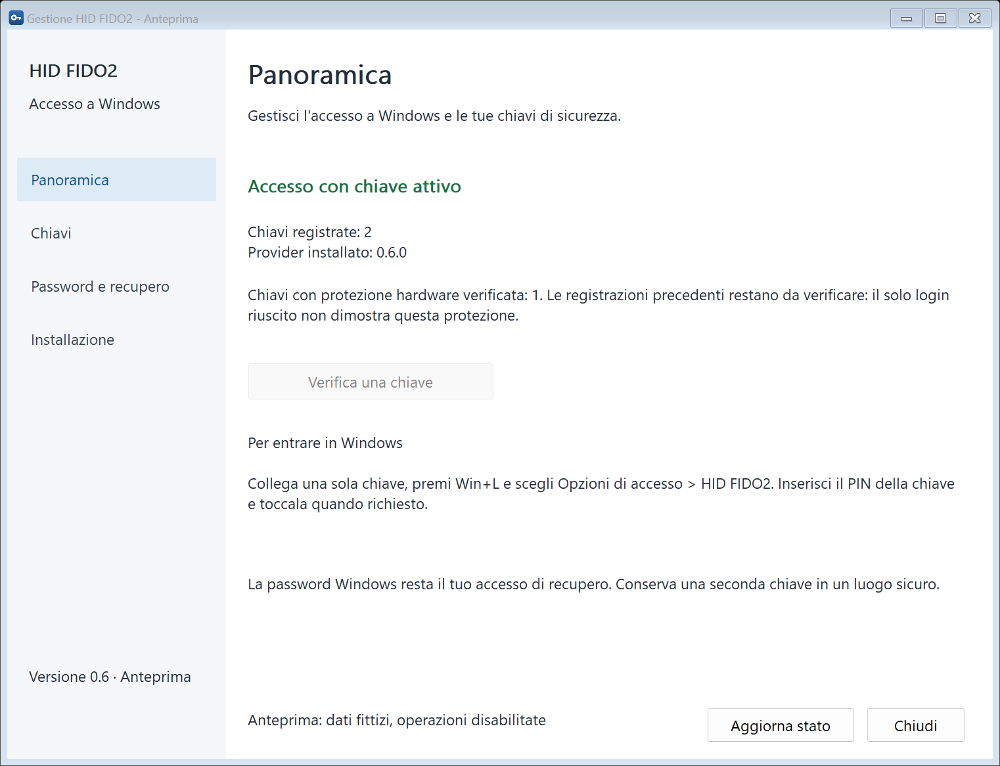
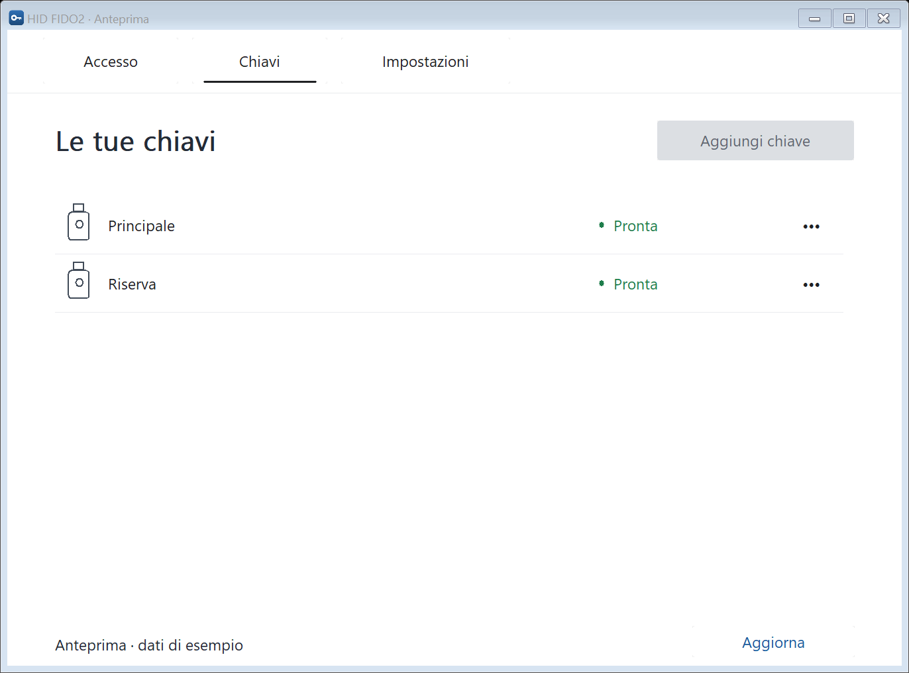
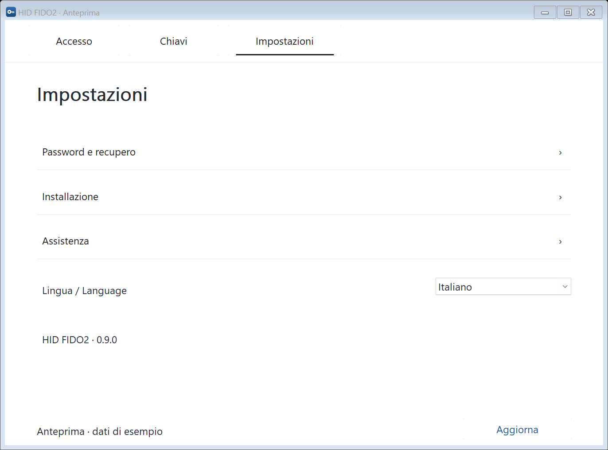
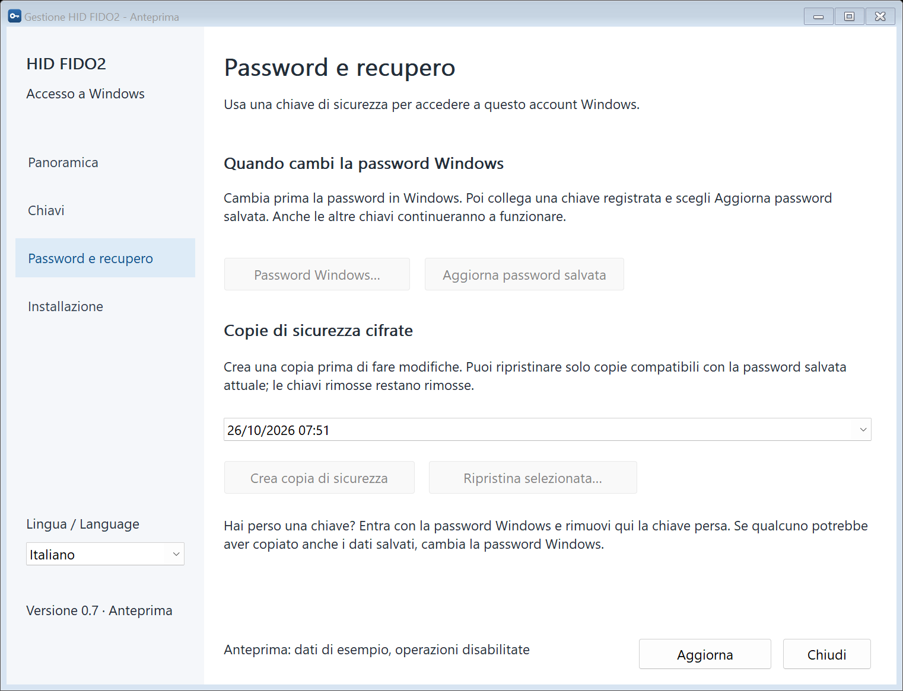
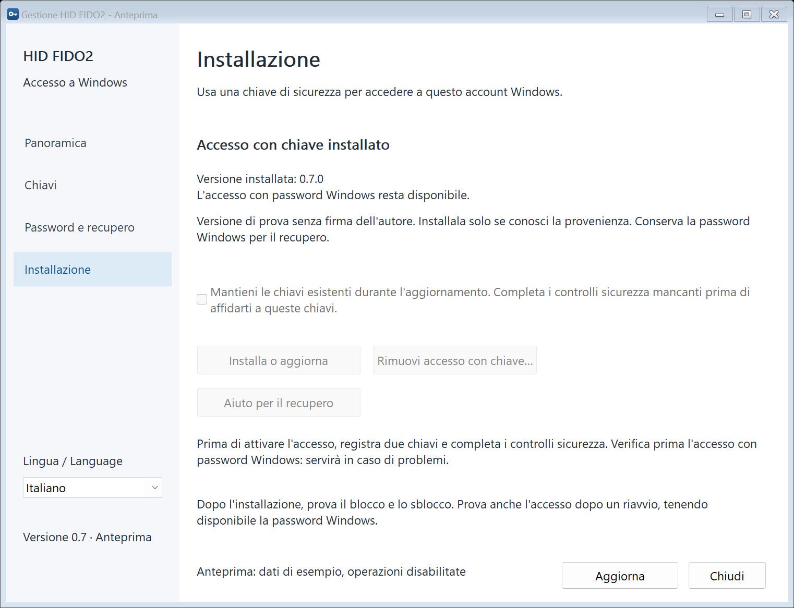
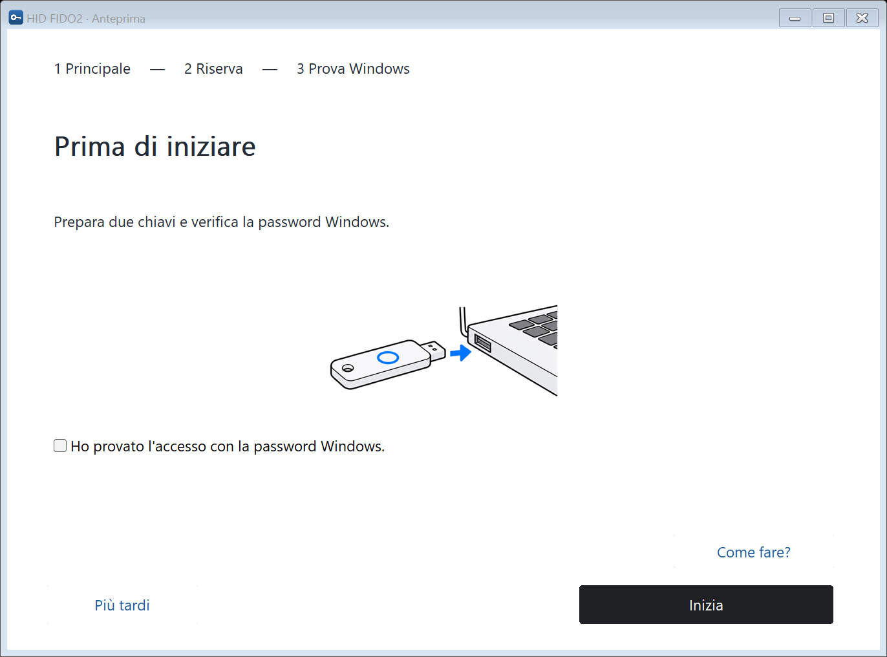
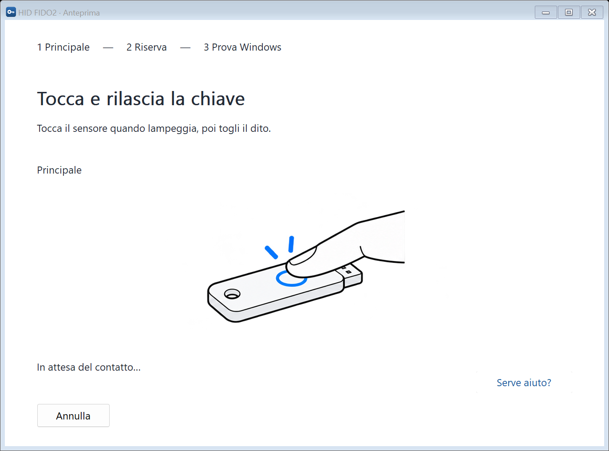
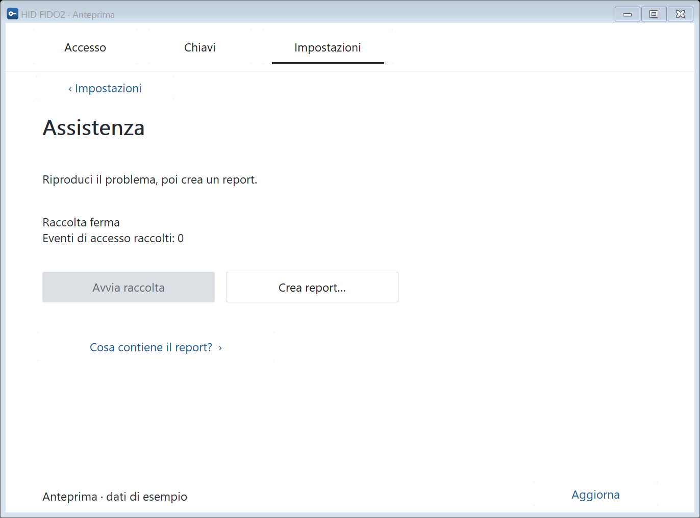

# HID FIDO2 Windows Logon

[English](README.md) · [Italiano](README.it.md)

Applicazione Windows e Credential Provider nativi in C++ per accedere a un
account locale e sbloccare il computer con una chiave di sicurezza USB FIDO2.

**Software sperimentale.** La password Windows viene conservata cifrata,
recuperata dopo una verifica FIDO2 e consegnata all'autenticazione standard di
Windows. Il provider usa la password e non sostituisce l'autorità di
autenticazione Windows. Mantieni una password Windows funzionante per il recupero.

## Funzionalità

- Gestore Win32 nativo con tre schede: Accesso, Chiavi e Impostazioni.
- Configurazione illustrata con un'azione alla volta, menu delle chiavi e report locali.
- Italiano e inglese, con scelta della lingua salvata e istruzioni in linguaggio semplice.
- CTAP2 / USB HID con verifica del PIN FIDO2 e della presenza dell'utente.
- Protezione `hmac-secret` separata per chiave e prove hardware memorizzate.
- Archivio macchina cifrato, aggiornamento password e copie protette compatibili.
- Installazione, aggiornamento, rollback e rimozione nativi.
- Hash del pacchetto, pin dell'editore, Authenticode e firma del manifest.
- Applicazione e installer senza PowerShell, .NET, browser, driver USB
  personalizzati o servizi di rete.
- Scheda **File** e menu di Esplora file: cifra file e cartelle nel formato
  standard age, in modo che si aprano con la Principale, la Riserva o una
  chiave di recupero su carta.

Versione attuale: **0.9.0** ([novità e verifiche](docs/release-notes-0.9.md)).
Il pacchetto di installazione è un'anteprima sperimentale non firmata.
Scegli **Italiano** o **English** da
**Impostazioni → Lingua / Language**. La pagina cambia subito e la
scelta viene salvata per questo computer. I nuovi dialoghi delle chiavi e il
componente di accesso al successivo caricamento usano la stessa lingua.
I nomi delle chiavi già registrate restano invariati.

## Schermate di esempio

Schermate del gestore nativo, acquisite dalla versione 0.9.0 in modalità
`--demo`. Gli esempi usano dati fittizi e hanno le operazioni reali
disabilitate: non mostrano credenziali o risultati di verifica hardware
effettivi del computer.

**Accesso** — stato attuale, una sola azione successiva e istruzioni espandibili.



<details>
<summary>Chiavi, impostazioni e configurazione illustrata</summary>

**Chiavi** — elenco delle chiavi e stato separato delle prove di protezione hardware.



**Impostazioni** — recupero, installazione, assistenza e lingua.



**Password e recupero** — aggiornamento della copia cifrata e gestione delle copie protette dell'archivio.



**Installazione** — stato del provider, installazione, rimozione e guida di recupero.



**Configurazione guidata** — recupero con password, due chiavi, controlli e prove in Windows.



**Guida fisica** — istruzione breve e illustrazione dell'operazione in corso.



**Assistenza** — raccolta diagnostica avviata dall'utente e anteprima prima del salvataggio.



</details>

## Requisiti e ambito

| Componente | Ambito supportato |
| --- | --- |
| Sistema | Windows 11 x64 |
| Account | Locale; la gestione deve elevarsi con lo stesso account |
| Chiave | USB FIDO2, ES256, PIN protocol 1 e `hmac-secret` |
| Recupero | Password Windows corrente e seconda chiave registrata |
| Runtime | API Windows e runtime MSVC x64 usato da provider e strumenti |

Durante lo sviluppo è stata utilizzata HID Crescendo. Altre chiavi, build
Windows, account Microsoft, dominio/Entra e RDP non sono convalidati. I test
automatici non dimostrano la compatibilità del login reale su un dispositivo.
La versione non è certificata o pronta per una distribuzione generale in produzione.

## Installazione da un pacchetto pronto

Scarica lo [ZIP di installazione Windows x64](https://github.com/emilius3m/HID-FIDO2-Windows-Logon/releases/download/v0.9.0/HID-FIDO2-Windows-Logon-0.9.0-x64.zip)
e il relativo checksum SHA-256 dalla [Release v0.9.0](https://github.com/emilius3m/HID-FIDO2-Windows-Logon/releases/tag/v0.9.0).
La release è un'anteprima sperimentale non firmata.

Estrai l'intero ZIP di distribuzione e apri
`app/Gestione-HID-FIDO2.exe`. L'eseguibile comprende gestore e installer
nativi. Mantieni accanto `release.json` e la directory `bin`: il solo
eseguibile non è sufficiente.

Le distribuzioni locali sono conservate in `dist/`, esclusa dal controllo
versione. Gli ZIP sono pubblicati come allegati delle GitHub Release.

## Compilazione e test

Servono Visual Studio 2022 o Build Tools con sviluppo desktop C++, Windows
SDK **10.0.22621.0** e CMake **3.24 o successivo**. Da Developer Command Prompt,
nella radice del repository:

```cmd
cmake --preset windows-x64
cmake --build --preset release
ctest --preset release
```

Le suite verificano crittografia, cifratura di file age (compresi i vettori di
test C2SP), framing e annullamento CTAP, integrità e
concorrenza dell'archivio, serializzazione del login, caricamento COM isolato,
pacchetti e deployment nativo. I test di registro usano una chiave HKCU
temporanea privata, senza registrare il provider in HKLM.

Per vedere l'interfaccia con dati fittizi e operazioni reali disabilitate:

```cmd
build\Release\Gestione-HID-FIDO2.exe --demo --language it
```

La [guida di compilazione](docs/building.md) descrive diagnostica opzionale e
configurazione delle release firmate.

## Creazione del pacchetto

```cmd
start /wait "" build\Release\Gestione-HID-FIDO2.exe --package "%CD%\build\Release" "%CD%\out\releases" --result "%CD%\out\package.json"
```

Usa ogni volta un nome nuovo per il risultato. La creazione del pacchetto non
installa o registra componenti. La directory generata contiene:

```text
Gestione-HID-FIDO2.exe
bin/HidFido2CredentialProvider.dll
bin/hid-fido2-files.exe
bin/hid-fido2-vault.exe
bin/provider-smoke.exe
release.json
```

Una release firmata aggiunge `release.p7s`. Conserva la directory completa:
payload mancanti, alterati o inattesi vengono rifiutati.

## Utilizzo

1. Apri `Gestione-HID-FIDO2.exe` da un pacchetto completo attendibile. Conferma
   UAC con lo stesso account Windows; le build locali non firmate richiedono
   il consenso esplicito al prototipo.
2. Registra una chiave principale e una di riserva nei dialoghi nativi.
   Inserisci password Windows e PIN della chiave soltanto in quelle finestre.
3. Installa il provider da **Impostazioni → Installazione**, dopo aver verificato che
   l'accesso di recupero con password Windows funzioni.
4. Blocca Windows, scegli **Opzioni di accesso → HID FIDO2**, inserisci il PIN
   della chiavetta e toccala quando richiesto.

Il gestore installato è **Gestione HID FIDO2** in Start e sul Desktop. Dopo
aver cambiato la password Windows, scegli **Impostazioni → Password e recupero → Aggiorna
password salvata**. Consulta la [guida d'uso](docs/usage.md).

## Cifratura di file e cartelle

Nel gestore, scheda **File**, aggiungi una volta la Principale e la Riserva e
crea una chiave di recupero su carta. Poi usa **Cifra file…**, **Cifra
cartella…** e **Decifra…**, oppure il tasto destro in Esplora file dopo aver
attivato il menu.

- Per cifrare servono un PIN e un tocco per **ciascuna** chiavetta del profilo;
  per aprire basta una chiavetta qualsiasi oppure la chiave su carta. Una
  cartella diventa un unico file `NOME.tar.age`: un tocco per chiave,
  indipendentemente dal numero di file.
- La chiave di recupero viene mostrata **una sola volta**: scrivila o stampala
  e conservala lontano dalle chiavette. Non viene salvata sul computer.
- Il PIN si digita solo nella finestra di Windows. Le operazioni girano con i
  normali diritti dell'utente, senza UAC, e non sovrascrivono mai file esistenti.
- Il profilo `destinatari.txt` contiene solo dati pubblici: conservane una copia
  insieme ai file cifrati.
- Le chiavette richiedono Windows 11 22H2 o successivo. Con la chiave di recupero
  i file si aprono anche con il programma `age` ufficiale su qualsiasi sistema.
  `hid-fido2-age.exe` offre le stesse operazioni da riga di comando.

Dettagli, limiti e note di sicurezza (in inglese) sono in
[file and folder encryption](docs/file-encryption.md).

## Sicurezza e recupero

L'archivio usa AES-256-GCM e protegge la chiave dei dati separatamente con ogni
chiavetta. L'accesso è limitato a SYSTEM e Administrators. I PIN non sono
persistiti e i segreti decifrati vengono cancellati dopo l'uso.

Un login riuscito non dimostra da solo la protezione hardware dalle richieste
senza PIN. Una nuova registrazione richiede un rifiuto esplicito o un segreto
distinto nella prova indipendente; un esito inconcludente interrompe la procedura.

Il provider password di Windows resta disponibile. La rimozione del provider
conserva l'archivio. Le copie compatibili preservano revoche e contatori
correnti e non ripristinano vecchie generazioni della password. Non sostituiscono
un recupero completo del computer.

Una sintesi in inglese di vantaggi, passaggi dello sblocco e motivi di sicurezza è in
[benefits and security overview](docs/security-overview.md).

Prima dell'attivazione leggi [modello di sicurezza](SECURITY.md) e
[istruzioni di recupero](docs/recovery.md). Per distribuire il software servono
un certificato reale e una [procedura di firma](docs/signing.md) convalidata.

## Struttura del progetto

| Directory | Contenuto |
| --- | --- |
| `src/manager` | Gestore desktop, packaging e deployment nativi |
| `src/credential_provider` | Provider COM, serializzazione e diagnostica pubblica |
| `src/ctap` | CTAP2, PIN protocol, USB HID e prove di protezione |
| `src/vault`, `src/password` | Archivio macchina e cifratura autenticata |
| `src/age` | Formato age, destinatari FIDO2 PRF, helper dei file e riga di comando |
| `src/ui`, `resources` | Dialoghi nativi, icona e risorse di versione |
| `include/hidfido` | Interfacce condivise |
| `tests` | Test automatici isolati |
| `docs` | Architettura, uso, build, firma e recupero attuali |

[Architettura](docs/architecture.md) · [Licenza MIT](LICENSE)
