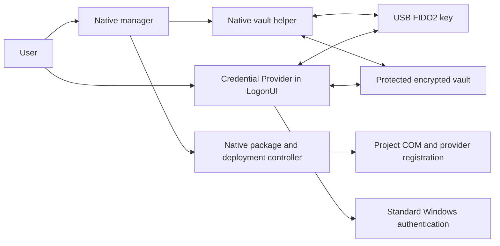

# Architecture

## Components

The manager handles status and orchestration. Interactive secret collection
and FIDO2 operations run in the native vault helper. The manager captures
bounded JSON metadata from the dedicated status command and, only during
an explicitly started support collection, allowlisted numeric diagnostics.
It never receives the password/PIN buffers used by the interactive helper.

The provider supports Windows logon and workstation unlock. It uses the
machine vault and direct CTAP2 USB HID access, without a browser or the
Windows WebAuthn dialog in LogonUI. Its COM interface submits standard
Windows password serialization; it is not an authentication authority.

## Setup and support

The manager's `main.cpp` handles bootstrap and command-line modes;
`window.cpp` implements the three-tab desktop interface. The pure
`experience.cpp` model selects a truthful status and next action. Missing
hardware checks and stale passwords are not presented as ready.

The shared `GuidanceView` contains presentation only. In real interactive
operations it lives in the vault helper, with a UI thread and a separate
CTAP worker. Only that helper reads the masked secret field into erased
buffers. Cancellation wakes input waiters and is polled during USB waits
and HID requests; it does not undo work already committed. Connection,
removal and CTAP responses drive their steps; the finger-release gesture
requires explicit acknowledgement. PNG illustrations are embedded in the
two executables and are not inputs to a security decision.

The setup model derives the next step from observed status and user
confirmations. Recovery acknowledgement is session-local. Windows-trial
confirmations are presentation preferences under
`HKCU\SOFTWARE\HID-FIDO2-WinLogon\UserInterface`, bound to a hash of public
configuration state (password generation, key metadata and provider version/path).
Malformed or obsolete preferences are ignored. No secrets or credential IDs
are stored in those preferences. Successful sign-in or a checked UI box never creates a
hardware protection proof. Existing enrollment, verification and deployment
preconditions remain the authority for those operations.

Renaming is a locked metadata update with account/key authority and selected
label rechecks. The label is outside the authenticated encryption context;
only that label changes. In-flight verified key use preserves a concurrent
rename and still applies the normal counter/authority checks. Backups retain
the current labels when restoring a compatible password payload.

The manager controls a temporary real-time ETW session for the existing
Credential Provider diagnostic GUID. TDH reads only `Stage`, `A` and `B` with
fixed numeric sizes. Unknown stages and PIN-field UI events are discarded;
raw event strings, process headers and payloads are not kept. A dedicated
deadline thread stops collection after five minutes even while the manager
UI is blocked. Stop/start and TDH decoding have a separate synthetic test;
it does not submit Windows credentials or exercise LogonUI.
The deadline runs in the manager process, not a background service: forced
termination or a crash can leave its real-time ETW session until restart.
This path has no persistent trace file and must not be described as a
crash-resilient capture watchdog.

Helper JSONL is bounded and reconstructed from fixed stage/error enums and
numeric fields before report export. No generic status/exception serializer
is used. The report adds only selected aggregate state, a read-only audit
result and version information, with explicit preview and save.

## File encryption

The **File** page shows the user's recipient profile
(`%APPDATA%\HID-FIDO2-WinLogon\Files\destinatari.txt`, public data only) and
starts `bin/hid-fido2-files.exe` from the protected release. The elevated
manager launches it through the desktop shell (`Shell.Application.ShellExecute`
on Explorer's desktop window), so it runs with the user's normal rights; if no
shell is available it starts directly. The helper owns all cryptographic work:
WebAuthn PRF assertions, age encryption and decryption, recovery-key display,
entry and printing. The same helper serves the optional File Explorer verbs,
registered per user under `HKCU\Software\Classes` and re-pointed to the running
release and language whenever the manager starts. An existing default program
for `.age` files is never replaced.

The portable age core (`src/age`) is shared by the helper, the
`hid-fido2-age` command line and, as a static-CRT copy, the manager, which uses
it only to read the profile.

## Interface language

The shared UI catalog contains Italian and English text. The manager stores
only the selected language (`it` or `en`) in the 64-bit machine preference
`HKLM\SOFTWARE\HID-FIDO2-WinLogon\Preferences\Language`. This value affects
presentation only; it is not used for authentication, key authorization or
vault parsing. A missing or invalid value falls back to the Windows display
language for Italian, otherwise English. Helpers receive `--language it|en`
explicitly; key labels and machine-readable reports are not translated.
The sign-in DLL reads this preference outside `DllMain` and never writes it.

## Cryptographic flow

Enrollment creates a dedicated ES256 credential with `hmac-secret`, verifies
the assertion independently and checks hardware behavior without PIN after
reconnection. A random data key encrypts the Windows password with
AES-256-GCM. Each key protects that same data key through its own secret,
salt, authenticated context and HKDF-derived envelope.

At sign-in a fresh challenge, verified assertion and derived `hmac-secret`
output unlock the data key. The provider commits verified counter state
before releasing the password for Windows serialization. When either the
stored or received counter is nonzero, the received value must increase;
an all-zero pair is accepted and offers no counter-based clone detection.
The protected serialization is held in a pending cache that expires after
15 seconds or is consumed once by this provider. This is a cache policy,
not an expiry on the serialized Windows credential or a one-time password.
Windows authentication results determine whether the password generation is
suspended. Sensitive buffers are cleared on exit, cancellation and cache expiry.

Password changes re-encrypt the password payload while retaining key
wrappers, so enrolled keys continue to work. Concurrency checks prevent an
in-flight operation from overriding revocation or a newer password generation.

## Persistence

The vault is `%ProgramData%\HID-FIDO2-WinLogon\vault.bin`. It uses a bounded
versioned binary format with a corruption-detection checksum and authenticated
encrypted payloads. SYSTEM/Administrators-only ACLs protect the directory,
file and backup area. Compare-and-save operations use an interprocess lock.

Key metadata records protection state, verification version and time.
Unknown proof is preserved explicitly. The current schema is 2; schema
parsing and downgrade guards are covered by tests.

Backups contain encrypted per-account records. Restore validates account,
record identity, salt and password generation and preserves current key
authorities and counters.

## Deployment

The fixed release manifest identifies three helper/provider binaries and
the native manager. Protected copies live under
`%ProgramFiles%\HID-FIDO2-WinLogon\releases\<release-id>`. Deployment records
and recovery files live in its `deployments` directory.

The controller validates package trust, SID continuity across UAC, fallback
availability, vault readiness and COM loading before changing registration.
It saves recovery metadata first, removes only the matching project
registration, registers COM before the provider, verifies the result and
attempts compatible rollback after failure. Missing required values are an
error; explicitly partial cleanup is idempotent. Foreign values are preserved
by refusing conflicting operations.

Old binaries and vault data are retained during removal and rollback. The
controller never resets the Windows password or rolls back vault authorities.

## Tests

The provider is built separately for production and isolation tests. The test
DLL alone accepts a test vault path and cannot be packaged as production.
Cryptographic/CTAP tests use synthetic fixtures. Native registry tests create
an isolated HKCU subtree; production code uses fixed HKLM paths. End-to-end
hardware, LogonUI, reboot and recovery tests require separate manual validation.
