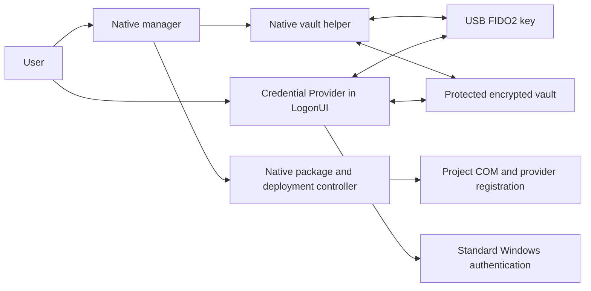

# Architecture

## Components

The manager handles status and orchestration. Interactive secret collection
and FIDO2 operations run in the native vault helper. The manager captures
only a bounded JSON metadata response from the dedicated status command.
It never receives the password/PIN buffers used by the interactive helper.

The provider supports Windows logon and workstation unlock. It uses the
machine vault and direct CTAP2 USB HID access, without a browser or the
Windows WebAuthn dialog in LogonUI. Its COM interface submits standard
Windows password serialization; it is not an authentication authority.

## Cryptographic flow

Enrollment creates a dedicated ES256 credential with `hmac-secret`, verifies
the assertion independently and checks hardware behavior without PIN after
reconnection. A random data key encrypts the Windows password with
AES-256-GCM. Each key protects that same data key through its own secret,
salt, authenticated context and HKDF-derived envelope.

At sign-in a fresh challenge, verified assertion and key secret unlock the
data key. The provider commits verified counter state before releasing the
password for Windows serialization. Its temporary result is protected,
single use and time bounded. Windows authentication results determine whether
the password generation is suspended. Sensitive memory is cleared on exit,
cancellation and expiry.

Password changes re-encrypt the password payload while retaining key
wrappers, so enrolled keys continue to work. Concurrency checks prevent an
in-flight operation from overriding revocation or a newer password generation.

## Persistence

The vault is `%ProgramData%\HID-FIDO2-WinLogon\vault.bin`. It uses a bounded
versioned binary format with a corruption-detection checksum and authenticated
encrypted payloads. SYSTEM/Administrators-only ACLs protect the directory,
file and backup area. Compare-and-save operations use an interprocess lock.

Key metadata records protection state, verification version and time.
Unknown proof is preserved explicitly. The current schema is 2; schema
parsing and downgrade guards are covered by tests.

Backups contain encrypted per-account records. Restore validates account,
record identity, salt and password generation and preserves current key
authorities and counters.

## Deployment

The fixed release manifest identifies three helper/provider binaries and
the native manager. Protected copies live under
`%ProgramFiles%\HID-FIDO2-WinLogon\releases\<release-id>`. Deployment records
and recovery files live in its `deployments` directory.

The controller validates package trust, SID continuity across UAC, fallback
availability, vault readiness and COM loading before changing registration.
It saves recovery metadata first, removes only the matching project
registration, registers COM before the provider, verifies the result and
attempts compatible rollback after failure. Missing required values are an
error; explicitly partial cleanup is idempotent. Foreign values are preserved
by refusing conflicting operations.

Old binaries and vault data are retained during removal and rollback. The
controller never resets the Windows password or rolls back vault authorities.

## Tests

The provider is built separately for production and isolation tests. The test
DLL alone accepts a test vault path and cannot be packaged as production.
Cryptographic/CTAP tests use synthetic fixtures. Native registry tests create
an isolated HKCU subtree; production code uses fixed HKLM paths. End-to-end
hardware, LogonUI, reboot and recovery tests require separate manual validation.
