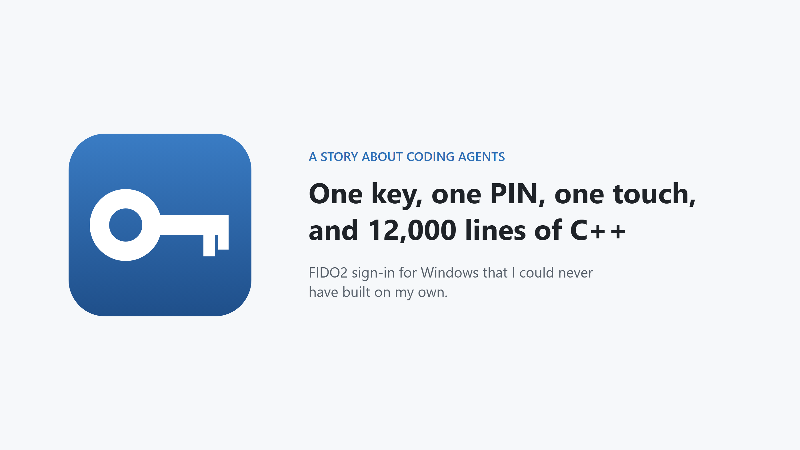
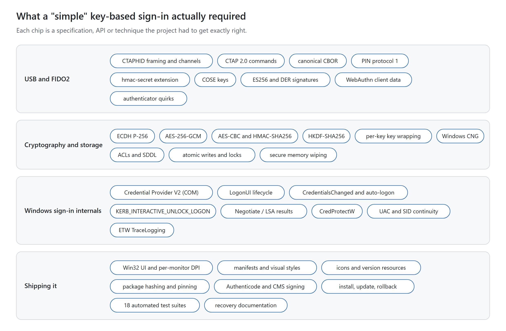
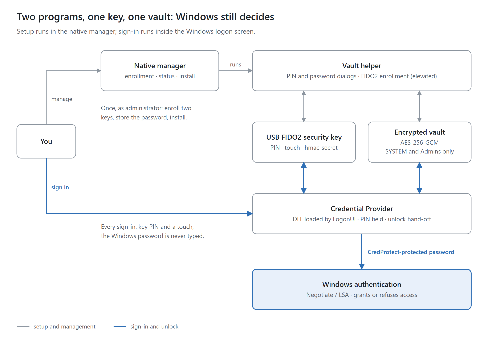
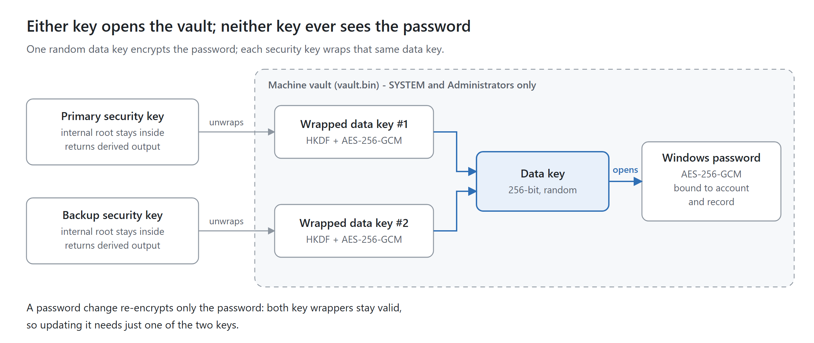
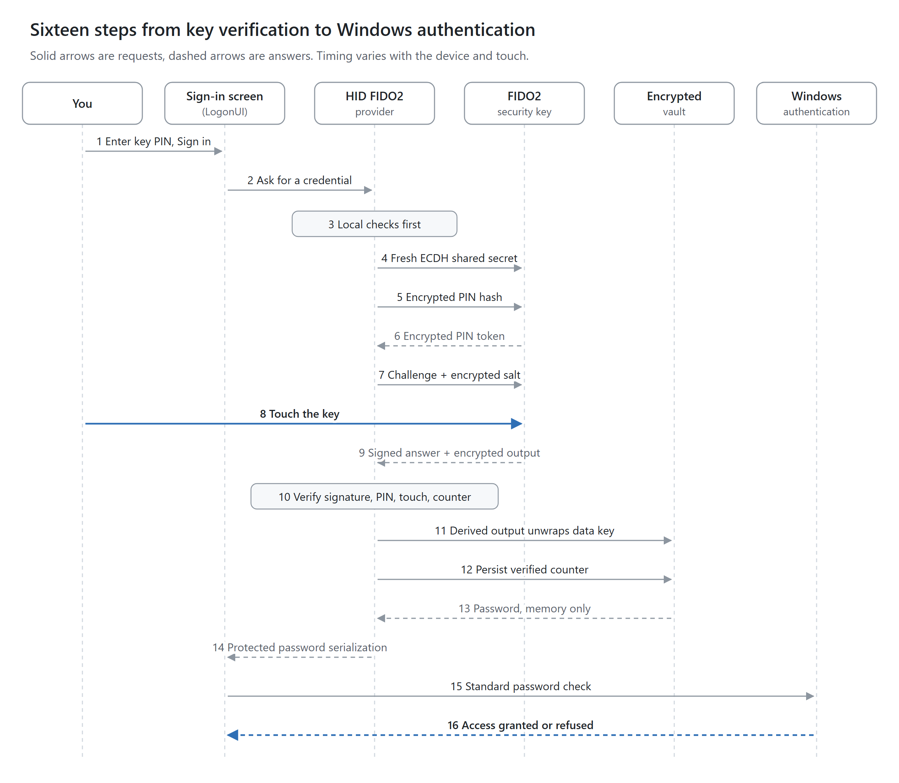
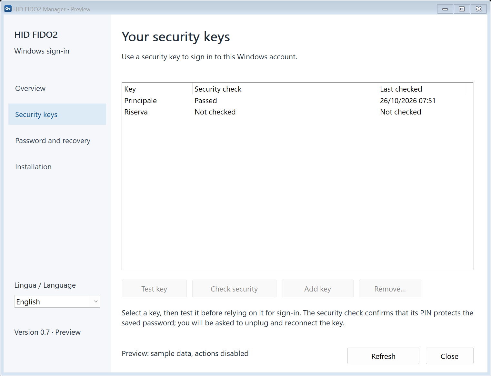
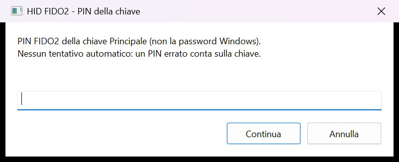

# I Could Never Have Built This Alone

## How coding agents turned "unlock Windows with a USB security key" from a fantasy into 12,000 lines of working C++

I wanted something that sounded simple. Plug in my FIDO2 security key, type
its PIN, touch it, and my Windows laptop unlocks. No password typed at the
sign-in screen. Seeing the key PIN over my shoulder would not be enough
without also possessing the key, under the hardware assumptions below.

Windows can already sign in with a security key, but only for accounts
managed through Microsoft Entra ID. For a plain local account there is
nothing built in. So I built it: an open-source credential provider called
[HID FIDO2 Windows Logon](https://github.com/emilius3m/HID-FIDO2-Windows-Logon).
Today it unlocks my machine in about two and a half seconds, most of which is
the time it takes me to touch the key.

I want to be honest about one thing from the start, because it is the real
point of this article. **I could not have built this without coding
agents.** I don't mean it would have taken longer. I mean it would not exist.
I would never have started it, or I would have given up at the first wall.

The problem was never typing the code. The problem was how much I would have
needed to know before I could write a single correct line.

## What a "simple" sign-in actually requires

Here is what the project ended up touching. Each chip is a specification, an
API or a technique that has to be exactly right, because in security
"almost right" means "broken".

*Every chip is something I would have had to study before writing the code that depends on it.*

Take just the first band. To talk to a security key over USB without a
browser, you have to speak **CTAPHID**: 64-byte USB reports, channels,
keep-alive messages and sequence numbers. On top of that sits **CTAP 2**,
whose messages are encoded in **canonical CBOR**, a binary format where even
the order of map keys is fixed. To send a PIN safely, the PIN protocol has you
agree a fresh shared secret with the device using **elliptic-curve
Diffie-Hellman on P-256**, then protect specific sensitive fields with AES and
HMAC-SHA-256. This does not encrypt the entire USB channel. To obtain a
derived secret from the key, you use the
**hmac-secret** extension, with its own encrypted salts and its own proof of
authenticity. Then you verify an **ES256 signature** over the key's
authenticator data.

That is one band out of four. The others cover how to store a Windows
password so that only the key can open it, how the Windows sign-in screen
actually loads and drives a credential provider (a COM object living inside
`LogonUI.exe`, with a lifecycle that is documented only in part), and
everything it takes to ship software that touches sign-in: per-monitor DPI,
code signing, packages that verify themselves, installation and rollback.

Each of those chips is a weekend of reading for an expert, and weeks for
someone like me. Multiply by thirty-four chips and the honest estimate is "not
in this life".

## How it works, in one picture

The idea is simple even if the parts are not. Your Windows password is
encrypted and stored in a machine vault. A derived output from the security
key unlocks the data key that decrypts it. The credential provider accepts
that output only with a verified signed assertion confirming PIN verification
and a touch. Enrollment separately tests that a client without PIN
verification cannot get the same output; this still depends on the key's
firmware and has not been independently certified. The provider decrypts the
password in memory and hands it to normal Windows authentication. Windows
still decides who gets in, and its normal password option remains available.

The key's signing private key and internal root secret stay inside the
device. The derived `hmac-secret` output is returned encrypted and becomes
available in the provider's memory, where it is used to unwrap the data key.

*Two programs share one key and one vault. Neither of them grants access: Windows does.*

The vault has one more trick. A random **data key** encrypts the password,
and each enrolled security key wraps that same data key separately. That gives
you a built-in spare: a primary key and a backup key can each open the vault
on their own. When you change your Windows password, only the password is
re-encrypted, and both keys keep working.

*Either key opens the vault; neither key ever sees the password.*

## Sixteen steps in two and a half seconds

This is what happens between pressing **Sign in** and seeing the desktop.

*Solid arrows are requests, dashed arrows are answers.*

A few of those steps carry most of the security:

- **Step 4:** each attempt uses a fresh ECDH shared secret. The PIN hash,
  PIN token, extension salt and derived output travel encrypted; other USB
  protocol fields remain visible. This key agreement alone does not verify
  the device's identity.
- **Steps 5 and 6:** the PIN is checked by the security key itself, which
  counts wrong attempts and locks itself after a few. My software never retries
  a PIN on its own.
- **Step 8:** the touch. No program can touch the key for you.
- **Step 10:** the answer is checked like a signed document: signature,
  challenge, relying-party binding, PIN-verified flag and touch flag. A
  recorded answer fails for a fresh challenge. Nonzero counters must also
  increase; all-zero counters are accepted, so counter checks cannot detect
  every cloned key.
- **Steps 11 to 13:** only now is the vault opened, and the password exists
  only in memory, for a few seconds.
- **Step 14:** the provider caches the protected password serialization for
  at most 15 seconds while waiting to submit it, and consumes that cache once.
  This limits retention in the provider; it does not make the password a
  one-time password or impose an expiry on Windows authentication.
- **Steps 15 and 16:** Windows checks the password with all its usual rules.
  Password-related rejections suspend the provider's record rather than
  repeating the same stale password. A failed submission can still count
  toward Windows account lockout.

I could explain all of this to you now. Before this project, I could not have
explained a single step of it.

## What working with agents actually looked like

I used two coding agents, Anthropic's **Claude Code** and OpenAI's **Codex**,
sometimes on the same repository at the same time. People imagine this as
"you type a wish and code appears". It was nothing like that. It was much more
like leading a small team of very fast, very well-read engineers who had never
seen my hardware.

My part of the work:

- **Deciding what to build** and saying "no" when a shortcut weakened
  security.
- **Being the hands.** Agents cannot touch a USB key, unplug it and plug it back
  in, press Win+L or watch an LED. Every hardware test needed me.
- **Running anything privileged.** The agents built and tested as a normal
  user; I ran the steps that needed administrator rights.
- **Keeping secrets out of the conversation.** One rule held from day one: my
  PIN and my Windows password never went into a chat window. The agents built
  small native dialogs so that secrets were typed only on my machine, into the
  program that needed them.
- **Refereeing.** When both agents were working, I paused one so the other
  could finish, and asked each to review the other's changes.

The agents' part was everything else: reading the specifications, writing the
CBOR encoder and the USB framing, the PIN protocol, the vault format, the
credential provider, the installer, eighteen automated test suites, the
documentation, and even the diagrams in this article, which are generated
from a short Python script.

*The native manager in demo mode, with synthetic data. The interface is in Italian, my language.*

*Each key records whether its protection was verified on real hardware. A successful sign-in never upgrades that claim on its own.*

*Secrets are typed into small local dialogs, never into a console or a chat. A wrong PIN counts on the key, so the software never retries one.*

I can't show you the sign-in tile itself: Windows does not allow screenshots
of the secure sign-in desktop.

## Stories from the bench

The moments that convinced me were not when code appeared. They were the
moments when something failed on real hardware and I had no idea why.

**The key that went dark.** After a touch, my key sometimes stopped
answering when the software opened a new USB channel, and its light went off.
I would not even have known where to start. The agent wrote a
diagnostic test, asked me to unplug and replug the key in a specific order,
read the raw responses I pasted back, and suspected USB power saving. We never
fully proved the cause. Instead we made the software robust: it verifies every
channel with a harmless request before trusting it, retries the
initialisation, and keeps to a single channel.

**"Operation denied."** During enrollment the key needs two touches. When the
second request came immediately after the first, the key refused it with an
error code I had never heard of. The fix was human-shaped: a short dialog
that tells you to get ready before asking for the next touch.

**The sign-in that vanished.** The provider unlocked the vault, prepared the
credential, and then nothing happened. The answer was in how LogonUI drives a
credential provider: it can detach the provider in the middle of a sign-in,
and my code dutifully threw the ready credential away. One agent found the
cause; the other wrote the fix. The fix was a few lines. The test that proves
it mattered more: remove the fix and the test fails. After the fix, a Windows
event trace I recorded showed the whole chain, from my touch to Windows
returning success.

**The installer you could not see.** My double-click installer started and
showed nothing. The agent reproduced it, measured that the window existed but
was invisible, and traced it to an old Windows rule: the show-window setting a
process is started with is silently applied to the first window it opens. My
launcher had hidden a console, and Windows had hidden my installer too.

**When "we can't tell" must mean "no".** Enrollment checks that a client
without PIN verification cannot obtain the same derived output. On my key
that check was sometimes inconclusive. At first we accepted the only clean
result we could get.
In a later version the rule became strict: an inconclusive result rejects
the key. Writing that rule takes one line of code; deciding it is a security
judgement, and that is the part that stayed with me.

Every one of these needed knowledge that I didn't have: USB HID behaviour, the
CTAP status codes, the LogonUI lifecycle, Windows event tracing, process
startup rules. The agents had that knowledge. I had the problem, the
hardware, and the final word.

## Two agents, one codebase

Halfway through, the project went through a complete rewrite. The first
versions relied on PowerShell scripts for installation and management. Version
0.6 replaced all of them with native C++: a native management window, a
package that verifies its own hashes before and after asking for administrator
rights, and no script interpreter anywhere. Today it is about 8,500 lines of
C++ plus 3,900 lines of tests.

That rewrite is the best example of what changed for me. A rewrite of that
size is something you simply don't attempt alone, on a project nobody pays you
for. With agents, it was a decision rather than a sacrifice.

Running two agents taught me something unexpected: they are good reviewers of
each other. One would diagnose a problem and the other would fix it. One
would relax a check to get unblocked and the other would put it back. My job
was to notice, decide, and keep them from editing the same file at the same
time.

## What the agents did not do

I want to be just as clear about the limits.

- **They did not replace judgement.** The agents proposed; I decided, and
  sometimes they disagreed with each other.
- **They did not make it audited.** The project is experimental. It has never
  had an independent security review or a penetration test. An agent helped
  write it; an independent human should audit it.
- **They did not remove the password.** The Windows password still exists,
  encrypted on disk and briefly in memory, and it stays my recovery path,
  along with a second enrolled key.
- **They could not touch the hardware.** Every claim about real behaviour
  comes from tests I ran with my own hands, and each release needs testing
  again on the target device.

## What changed for me

Coding agents are usually sold on speed: the same work, faster. That was not
my experience. For me they changed what was possible at all.

The barrier between me and this project was never typing. It was a dozen
specifications, a sign-in screen that is documented only in part, and a
cryptographic design in which every detail matters. Agents collapsed the cost
of learning by doing across all of those domains at once. I could ask "why",
get an answer grounded in the specification, try it on the hardware, and move
on, again and again.

I was the person with the problem, the hardware and the final word. The
agents were the team I did not have.

*The code, the security model and an English benefits-and-security overview
are on GitHub:
[emilius3m/HID-FIDO2-Windows-Logon](https://github.com/emilius3m/HID-FIDO2-Windows-Logon).
It is experimental software: keep your Windows password and a backup key, and
read the recovery guide before you enable it.*
