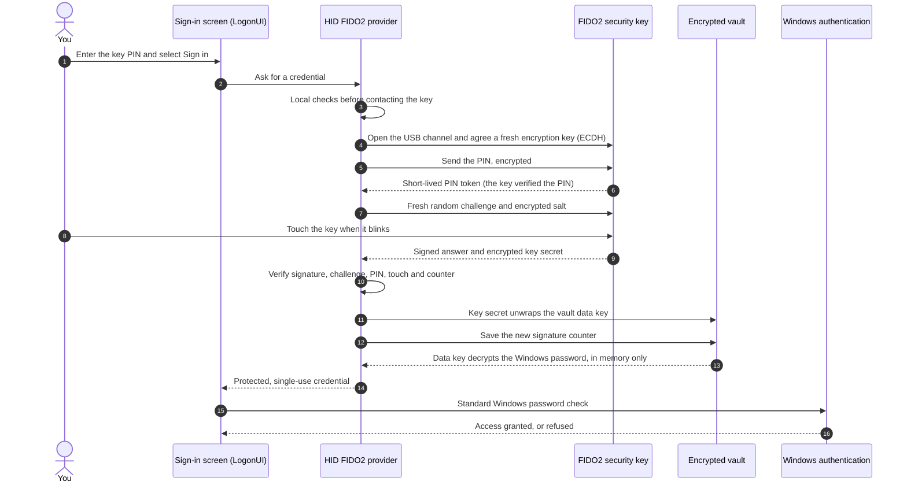

# Benefits and security overview

HID FIDO2 Windows Logon lets you sign in to and unlock a local Windows account
with a USB FIDO2 security key, its PIN and a touch, instead of typing the
Windows password. This page explains the benefits, walks through what happens
during an unlock and why each step is safe, and lists the limits that still
apply. The [security model](../SECURITY.md) is the technical reference.

> Experimental software: not certified or independently audited. Keep the
> Windows password and a second enrolled key as recovery options.

## Benefits at a glance

- **Two factors instead of one.** Signing in needs the physical key *and* its
  PIN, confirmed by a touch. A stolen key without the PIN, or a PIN seen over
  someone's shoulder without the key, is not enough.
- **No password typed at the sign-in screen.** The Windows password stays in
  an encrypted vault and is handed to Windows without being shown or typed.
- **A spare key built in.** A primary and a backup key each open the same
  vault independently; losing one key does not lock you out.
- **Windows stays in charge.** The project submits the password to standard
  Windows authentication, which still enforces lockout, expiry and account
  restrictions. It does not install an authentication package, modify LSASS,
  replace Windows Hello or change Secure Boot or code-integrity policy.
- **Offline and local.** No network service, browser or cloud account is
  involved; every operation happens on the device.
- **Additive and reversible.** The normal password sign-in remains available,
  and the provider can be removed without touching the Windows password.
- **Small, native footprint.** Native C++ only: no PowerShell, .NET, custom USB
  driver or background service. Packages are hash-verified and can be signed.

## What happens during an unlock

From *Sign in* to an unlocked session takes about 2.5 seconds on the
development device, most of it waiting for the touch. Solid arrows are
requests, dashed arrows are answers.

| Step | What happens | Why it is safe |
| --- | --- | --- |
| 1-3 | You type the key PIN on the sign-in screen. The provider checks that the account is enrolled and active, that the PIN is well formed and that exactly one key is attached. | Problems are caught before the PIN reaches the key. The PIN is never displayed, logged or stored. |
| 4 | The provider opens and verifies the USB channel, then agrees a new encryption key with the security key (ECDH P-256). | Anyone listening on the USB cable sees only data encrypted with throwaway keys, different at every sign-in. |
| 5-6 | The PIN travels encrypted; the key checks it and returns a short-lived token. | The key counts wrong PINs and blocks itself after a few; the software never retries a PIN on its own. |
| 7 | The provider sends a fresh random challenge and, encrypted, the salt from which the key derives its secret. | An answer recorded earlier is useless for a new challenge. |
| 8 | The key blinks and you touch it. | Proof of physical presence: no program can touch the key for you. |
| 9 | The key signs its answer with a private key and computes the secret with `hmac-secret`. | The private key and the internal secret never leave the security key. |
| 10 | The provider verifies the signature, the challenge, the relying-party binding, PIN verification (UV), touch (UP), the signature counter and the signed extension. | An incomplete, altered, replayed or foreign answer is rejected. |
| 11 | The secret unwraps the vault's data key (HKDF and AES-256-GCM, bound to the account and to this key). | Without the physical key's secret the vault cannot be decrypted; the file alone is useless. |
| 12 | The new signature counter is saved before anything else is released. | A cloned key with an older counter would be detected and refused. |
| 13 | The data key decrypts the Windows password into protected memory; key material is wiped. | The password is never written to disk in clear text or shown. |
| 14 | The password, protected for Windows with `CredProtectW`, is offered once and expires after 15 seconds. | A leftover credential cannot be reused later. |
| 15-16 | Windows checks the password with its usual rules and unlocks the session. | Lockout, expiry and account restrictions apply as before. If Windows rejects the stored password, key sign-in is suspended and never retried automatically. |

If the attached key is the backup key, steps 4-9 run first for the primary
key's credential, which the backup key does not hold: the key says so before
asking for a touch, and the provider moves on to the backup key's credential.

## Why the design is secure

1. **Possession, knowledge and presence are all required.** The vault opens
   only with a secret that the physical key computes after verifying its PIN
   and sensing a touch, and the provider checks the signed proof of all three.
2. **Nothing can be replayed.** Each sign-in uses a new USB encryption key, a
   new random challenge and a signature counter that must increase.
3. **Secrets stay where they belong.** The key's private key and secret never
   leave the device; the vault is encrypted and readable only by SYSTEM and
   Administrators; the password exists only briefly in protected memory and is
   handed to Windows protected.
4. **Windows remains the authority.** The project never decides who signs in
   and never creates a Windows token; it only supplies the same password a
   user would type.
5. **It fails safe.** Local problems stop before the key is contacted, PINs
   are never retried automatically, and a password rejected by Windows
   suspends key sign-in instead of risking an account lockout.
6. **Installation is verified.** Packages are checked against fixed hashes and
   a publisher pin before and after elevation, run from a protected copy, and
   management must elevate as the same account that uses the keys.

## Threats and how they are handled

| Threat | Handling |
| --- | --- |
| Stolen security key | The PIN is still required; the key limits PIN attempts. |
| Observed PIN | Useless without the physical key. |
| Copied vault file | AES-256-GCM encrypted; the decryption key derives from a secret inside the security key. |
| Recorded or forged key answers | Fresh challenge, signature check against the enrolled public key, increasing counter. |
| Secret obtained without the PIN | The provider requires signed PIN verification. Enrollment tests each key after reconnection: access without PIN must be denied or give a different secret, otherwise the key is rejected. |
| USB eavesdropping | PIN and secret travel encrypted under a per-session ECDH key. |
| Password changed elsewhere | Windows rejects the stored copy; key sign-in is suspended until the password is updated with an enrolled key. |
| Lost or broken key | The backup key opens the same vault; the Windows password always works. |
| Tampered installation | Hash and signature checks, protected immutable copies, no self-registration. |

## Limits and residual risks

- **Not certified or audited.** No independent review or penetration test has
  been performed yet.
- **Password-backed by design.** The Windows password still exists, encrypted
  on disk and briefly in memory. Whoever already controls the device as
  SYSTEM or Administrator, or through the kernel, can obtain it, as with any
  sign-in method.
- **Hardware assumptions.** Protection of the key secret without a PIN depends
  on the key's firmware; it is tested at enrollment but not certified. The
  project does not verify the key's manufacturer or genuineness.
- **Old vault copies.** Revoking a key affects the current vault only; someone
  holding both an old vault copy and a key it authorized could still decrypt
  that copy. Change the Windows password when this is possible.
- **Scope.** Windows 11 x64 and local accounts only; Microsoft, domain and
  Entra ID accounts, RDP and other authenticators are not validated.
- **Signing.** Unsigned packages are for explicitly trusted local prototypes;
  distribution requires a real code-signing certificate.

## What has been verified

- Automated test suites cover the cryptography, the vault format and its
  tamper handling, the CTAP2 client and USB framing, the credential provider
  in isolation and the serialization handed to Windows.
- During development (October 2026), unlock through the installed provider was
  verified end to end on a Windows 11 test device with an HID Crescendo key,
  including a diagnostic trace in which Windows returned `STATUS_SUCCESS`.
  Each release must be validated again on the target device; see
  [recovery](recovery.md) before enabling it.

See also: [architecture](architecture.md) · [usage](usage.md) ·
[recovery](recovery.md) · [signing](signing.md) · [security model](../SECURITY.md)
