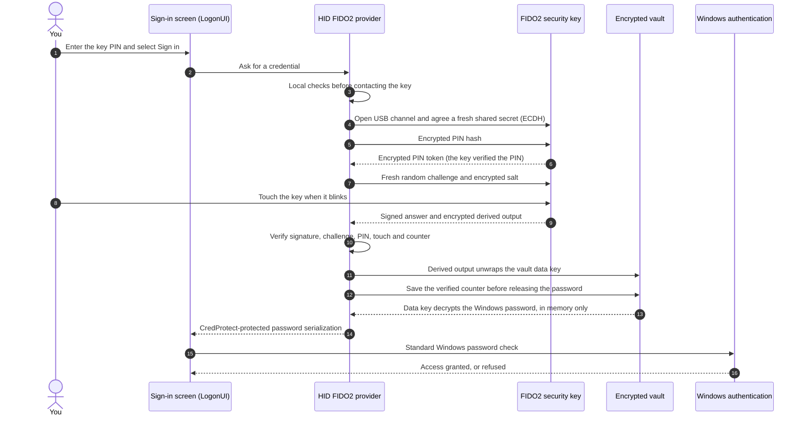

# Benefits and security overview

HID FIDO2 Windows Logon lets you sign in to and unlock a local Windows account
with a USB FIDO2 security key, its PIN and a touch, instead of typing the
Windows password. This page explains the benefits, walks through what happens
during an unlock, what each check protects, and the limits that still
apply. The [security model](../SECURITY.md) is the technical reference.

> Experimental software: not certified or independently audited. Keep the
> Windows password and a second enrolled key as recovery options.

## Benefits at a glance

- **Key and PIN for this sign-in method.** The provider requires the physical
  key, its PIN and a touch. This depends on the hardware assumptions below;
  it does not require two factors for every Windows sign-in, because the
  normal Windows password option remains available.
- **No password typed at the sign-in screen.** The Windows password stays in
  an encrypted vault and is handed to Windows without being shown or typed.
- **A spare key built in.** A primary and a backup key each open the same
  vault independently; losing one key does not lock you out.
- **Windows stays in charge.** The project submits the password to standard
  Windows authentication, which still enforces lockout, expiry and account
  restrictions. It does not install an authentication package, modify LSASS,
  replace Windows Hello or change Secure Boot or code-integrity policy.
- **Offline and local.** No network service, browser or cloud account is
  involved; every operation happens on the device.
- **Additive and reversible.** The normal password sign-in remains available,
  and the provider can be removed without touching the Windows password.
- **Small, native footprint.** Native C++ only: no PowerShell, .NET, custom USB
  driver or background service. Packages are hash-verified and can be signed.

## What happens during an unlock

Reported development runs took about 2.5 seconds from *Sign in* to an
unlocked session, including the wait for a touch. This is a device-specific
observation, not a benchmark or a guarantee for version 0.6.0 on other devices.
Solid arrows are requests, dashed arrows are answers.

| Step | What happens | Protection and limits |
| --- | --- | --- |
| 1-3 | You type the key PIN on the sign-in screen. The provider checks that the account is enrolled and active, that the PIN is well formed and that exactly one key is attached. | These local checks happen before PIN verification. The field is masked; the PIN is held temporarily in process memory, not logged or persisted. |
| 4 | The provider initializes the USB channel and agrees a fresh shared secret with the security key (ECDH P-256). | The PIN protocol protects selected sensitive fields. It does not encrypt all USB traffic or establish the device's identity through this key agreement. |
| 5-6 | An encrypted truncated hash of the PIN is sent; the key checks it and returns an encrypted PIN token. | The key enforces its PIN retry limits; the software does not retry a rejected PIN automatically. |
| 7 | The provider sends a fresh random challenge and, encrypted, the salt from which the key derives its secret. | An answer recorded earlier is useless for a new challenge. |
| 8 | The key blinks and you touch it. | Proof of physical presence: no program can touch the key for you. |
| 9 | The key signs its answer and computes a derived output with `hmac-secret`. | The private key and internal root secret remain on the device. The derived output is returned encrypted and decrypted by the provider in memory. |
| 10 | The provider verifies the signature, the challenge, the relying-party binding, PIN verification (UV), touch (UP), the signature counter and the signed extension. | An incomplete, altered, replayed or foreign answer is rejected. |
| 11 | The derived output unwraps the vault's data key (HKDF and AES-256-GCM, bound to the account and to this key). | A copied vault alone does not contain the key material needed to decrypt the password. Compromise of the trusted processes or key material is outside this protection. |
| 12 | The verified signature counter is saved before the password is decrypted. | When either the stored or received counter is nonzero, the received value must increase. An all-zero pair is accepted and cannot provide counter-based clone detection. |
| 13 | The data key decrypts the Windows password into a temporary buffer; sensitive buffers are cleared after use. | Memory locking is best effort. The application does not intentionally persist or display the plaintext password; a compromised privileged process can still capture it. |
| 14 | The provider caches the `CredProtectW`-protected serialization for at most 15 seconds while it awaits submission, and consumes its cached copy once. | This limits retention and repeat submission by this provider. It is not an expiry enforced by `CredProtectW` or Windows authentication, and it does not make the Windows password a one-time password. |
| 15-16 | Windows checks the password with its usual rules and grants or refuses access. | Lockout, expiry and account restrictions still apply. Password-related rejections suspend this provider's record to avoid repeating a stale password. An initial failed submission can still count toward lockout. |

If the attached key is the backup key, steps 4-9 run first for the primary
key's credential, which the backup key does not hold: the key says so before
asking for a touch, and the provider moves on to the backup key's credential.

## How the design protects sign-in

1. **This provider checks possession, verification and presence.** It accepts
   a signed assertion from an enrolled key only with user verification (UV)
   and user presence (UP). Enrollment separately tests whether a client
   without PIN verification can obtain the same derived output. Existing
   prototype records without that proof remain marked as unverified.
2. **Fresh assertions resist recorded-answer replay.** Each attempt uses a
   fresh random challenge and verifies the signature and relying-party
   binding. Nonzero counters must increase; authenticators with all-zero
   counters are also accepted. Counter checks cannot detect every clone.
3. **Secrets have separate boundaries.** The key's private key and internal
   root secret remain on the device. The derived output and decrypted data
   key are temporarily available to the provider. The vault is encrypted and
   readable only by SYSTEM and Administrators; the password is submitted to
   Windows using `CredProtectW` protection. The password remains reusable.
4. **Windows remains the authority.** The project never decides who signs in
   and never creates a Windows token; it only supplies the same password a
   user would type.
5. **Repeated failed attempts are limited.** Local preflight checks run before
   PIN verification, rejected PINs are not retried automatically, and
   password-related Windows rejections suspend the record. Windows account
   lockout remains possible under its normal policy.
6. **Packages are checked before installation.** Payload hashes are checked
   before and after elevation, and operations use a protected copy. Signed
   builds additionally enforce the configured publisher pin and manifest
   signature. Unsigned prototype hashes do not establish a publisher's
   identity. Management must elevate as the same account that uses the keys.

## Threats and how they are handled

| Threat | Handling |
| --- | --- |
| Stolen security key | The PIN is still required; the key limits PIN attempts. |
| Observed PIN | Useless without the physical key. |
| Copied vault file | AES-256-GCM encrypted; the decryption key derives from a secret inside the security key. |
| Recorded or forged key answers | Fresh challenge, signature and relying-party checks. Nonzero counters must increase; all-zero counters are accepted and provide no counter-based clone detection. |
| Secret obtained without the PIN | The provider requires signed PIN verification. Enrollment tests each key after reconnection: access without PIN must be denied or give a different secret, otherwise the key is rejected. |
| USB eavesdropping | The PIN hash, PIN token, extension salt and derived output are encrypted using ECDH-derived key material. Other protocol fields remain visible; this is not encryption of the entire USB channel. |
| Password changed elsewhere | Windows rejects the stored copy; key sign-in is suspended until the password is updated with an enrolled key. |
| Lost or broken key | A working enrolled backup key can open the vault. The Windows password option remains available, subject to the account's status and Windows policy. |
| Tampered installation | Payload hash checks and protected copies; publisher pin and signature enforcement in signed builds. Unsigned hashes alone cannot establish the package's origin. |

## Limits and residual risks

- **Not certified or audited.** No independent review or penetration test has
  been performed yet.
- **Password-backed by design.** The Windows password still exists, encrypted
  on disk and briefly in memory. Whoever already controls the device as
  SYSTEM or Administrator, or through the kernel, can capture it during use.
  This password exposure is a tradeoff of this design, not a claim about
  every other Windows sign-in method.
- **Hardware assumptions.** Protection of the key secret without a PIN depends
  on the key's firmware; it is tested at enrollment but not certified. The
  project does not verify the key's manufacturer or genuineness.
- **Old vault copies.** Revoking a key affects the current vault only; someone
  holding both an old vault copy and a key it authorized could still decrypt
  that copy. Change the Windows password when this is possible.
- **Scope.** Windows 11 x64 and local accounts only; Microsoft, domain and
  Entra ID accounts, RDP and other authenticators are not validated.
- **Signing.** Unsigned packages are for explicitly trusted local prototypes;
  distribution requires a real code-signing certificate.

## What has been verified

- Automated test suites cover the cryptography, the vault format and its
  tamper handling, the CTAP2 client and USB framing, the credential provider
  in isolation and the serialization handed to Windows.
- During development (October 2026), unlock through the installed provider was
  verified end to end on a Windows 11 test device with an HID Crescendo key,
  including a diagnostic trace in which Windows returned `STATUS_SUCCESS`.
  Each release must be validated again on the target device; see
  [recovery](recovery.md) before enabling it.

Protocol references: [FIDO CTAP `hmac-secret`](https://fidoalliance.org/specs/fido-v2.1-ps-20210615/fido-client-to-authenticator-protocol-v2.1-ps-20210615.html#sctn-hmac-secret-extension)
and [Microsoft `CredProtectW`](https://learn.microsoft.com/en-us/windows/win32/api/wincred/nf-wincred-credprotectw).

See also: [architecture](architecture.md) · [usage](usage.md) ·
[recovery](recovery.md) · [signing](signing.md) · [security model](../SECURITY.md)
